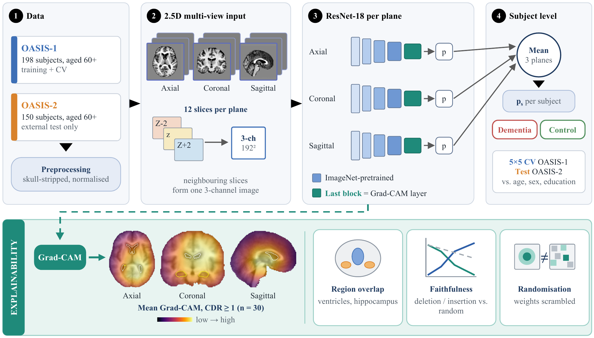
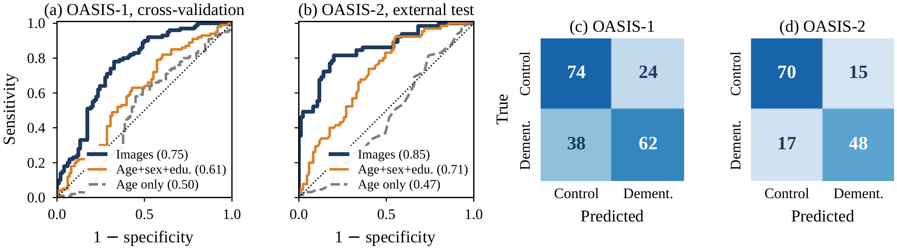
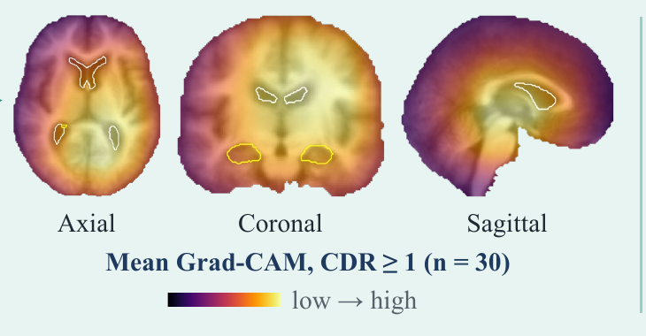

<div align="center">

# Age-Controlled Alzheimer's Disease Detection from Structural MRI

### A multi-view 2.5D CNN ensemble with subject-level and external validation


**Chayan Mondal Abir** · **P Santhiya**
SRM Institute of Science and Technology, Kattankulathur, India

</div>

> **Research prototype. Not a medical device and not for diagnosis.**
> The model was trained and tested only on OASIS research data.

---

## Overview

Many MRI dementia classifiers report accuracies above 98%, but these numbers often come from
*slice-level* data splits (slices of the same brain end up in both training and test sets) or from
cohorts where age alone separates patients from controls. This project asks a stricter question:

> **How well can a CNN detect dementia from structural MRI when every split is by subject, all participants are aged 60+, and the frozen model is tested once on a second cohort?**

| | |
|---|---|
| **Task** | Control (CDR 0) vs dementia (CDR > 0) |
| **Training data** | OASIS-1, 198 subjects aged 60+ (98 controls, 100 dementia) |
| **External test** | OASIS-2, 150 subjects aged 60+ (85 controls, 65 dementia), tested once |
| **Model** | One ImageNet-pretrained ResNet-18 per plane (axial, coronal, sagittal), averaged |
| **Input** | 12 slices per plane from the central 40% of the brain, stacked as z−2, z, z+2 (2.5D) |
| **Validation** | 5×5 repeated stratified cross-validation, split by subject |
| **Baselines** | Logistic regression on age, and on age + sex + education |
| **Explainability** | Grad-CAM, region overlap, deletion/insertion faithfulness, weight randomisation |

## Method at a glance

<p align="center"></p>

1. **Preprocessing.** OASIS-1 scans are used as supplied (atlas-registered, skull-stripped). OASIS-2 raw scans are reoriented, bias-field corrected (N4), skull-stripped (ANTsPyNet), scaled to the typical OASIS-1 brain size, centred on an average OASIS-1 template and normalised with the same intensity rule.
2. **2.5D multi-view input.** 12 slices per plane, each with its neighbours two positions before and after as three channels, resized to 192×192.
3. **Network.** ResNet-18 per plane, AdamW (lr 2e-4, weight decay 0.01), one-cycle schedule, batch 64, 12 epochs, weighted binary cross-entropy, light augmentation.
4. **Subject score.** Probabilities are averaged over the 12 slices and then over the three planes.

## Results

| Cohort | Model | AUC (95% CI) | Sens. | Spec. | Acc. |
|---|---|---|---|---|---|
| OASIS-1 (5×5 CV) | **Images** | **0.751** (0.686–0.825) | 0.62 | 0.76 | 0.69 |
| | Age + sex + education | 0.606 (0.523–0.686) | 0.59 | 0.59 | 0.59 |
| | Age only | 0.502 (0.425–0.587) | 0.61 | 0.51 | 0.56 |
| OASIS-2 (external) | **Images** | **0.852** (0.791–0.905) | 0.74 | 0.82 | 0.79 |
| | Age + sex + education | 0.711 (0.623–0.786) | 0.68 | 0.62 | 0.65 |
| | Age only | 0.466 (0.373–0.561) | 0.51 | 0.45 | 0.47 |

Threshold metrics use a fixed cut-off of 0.5. Confidence intervals come from bootstrapping subjects.
The images add about **+0.15 AUC** (OASIS-1) and **+0.142 AUC** (OASIS-2, 95% CI 0.051–0.239) over age, sex and education.

<p align="center"></p>

**Honest reading of the results**

- Age alone is close to chance in this 60+ cohort, so the image model is not simply learning age.
- Most missed cases are very mild dementia: 32 of 38 on OASIS-1 and 15 of 17 on OASIS-2 had CDR 0.5.
- Accuracy is far below the 98–99.9% often reported for slice-level splits, which we regard as a more realistic estimate for unseen subjects.
- Mirroring the OASIS-2 scans left to right raised the AUC to 0.916 for a reason we could not determine. It is reported as a limitation, and the original orientation is the main result.

### Explainability

<p align="center"></p>

Attention on the hippocampus and ventricles rises with severity (hippocampus enrichment 0.99 → 1.29 → 1.45 for CDR 0 → 0.5 → ≥ 1).
Insertion tests support the maps, while deletion tests do not, so we treat Grad-CAM only as supporting evidence.

## Repository structure

```
.
├── app/                    Streamlit demo (inference.py = preprocessing, prediction, Grad-CAM)
├── notebooks/
│   ├── 01_oasis2_preprocessing.ipynb              OASIS-2 raw scans -> prepared volumes
│   └── 02_training_evaluation_explainability.ipynb  CV, baselines, external test, Grad-CAM
├── scripts/                fetch_weights.py, make_extra.py
├── results/                aggregate result tables (no per-subject data)
├── docs/                   figures used in this README
├── paper/                  conference paper (LaTeX source and PDF)
├── weights/                trained networks (downloaded from the Release, not in git)
├── Dockerfile · requirements.txt · requirements-lite.txt
└── LICENSE · CITATION.cff
```

## Quick start: run the demo

The trained weights (about 650 MB) are attached to the [latest Release](../../releases).

```bash
git clone https://github.com/chayanmondalabir/alzheimers-mri-multiview.git
cd alzheimers-mri-multiview
python scripts/fetch_weights.py            # downloads weights/ from the Release

# Option A: prepared volumes only (.npz), works on a laptop
pip install -r requirements-lite.txt
streamlit run app/app.py

# Option B: raw T1 scans (.nii / .nii.gz), needs ANTs and TensorFlow (Linux recommended)
pip install torch torchvision --index-url https://download.pytorch.org/whl/cpu
pip install -r requirements.txt
streamlit run app/app.py

# Option C: Docker
docker build -t mri-demo . && docker run -p 8501:8501 mri-demo
```

Raw scans take a few minutes on CPU, because skull-stripping dominates the run time.
Uploaded files are deleted right after each run. Please do not upload data that identifies a person.

**Live demo:** _add link here after deployment_

## Reproducing the research

The data are **not included**. OASIS data are distributed under their own data use terms, so please obtain them directly:

1. Request OASIS-1 (cross-sectional) and OASIS-2 (longitudinal) from <https://sites.wustl.edu/oasisbrains/>.
2. Run `notebooks/01_oasis2_preprocessing.ipynb` to prepare the OASIS-2 volumes. It expects a `subjects_oasis2.csv` built from the official OASIS-2 demographics file (columns are listed in the notebook).
3. Run `notebooks/02_training_evaluation_explainability.ipynb` on a GPU (the notebooks were run on Kaggle). It trains the models, runs the cross-validation, the baselines, the external test and the explainability study, and saves the weights.

Settings were fixed before testing (12 epochs, no tuning on OASIS-2).

## Limitations

- Small cohort: 198 training subjects, only 30 with CDR ≥ 1; CDR 0.5 is merged with higher ratings.
- OASIS-1 and OASIS-2 come from one research programme, and OASIS-2 was aligned only by scaling and centring.
- The left–right orientation question for OASIS-2 is unresolved.
- The Grad-CAM analysis uses approximate atlas masks and one repeat, and the deletion test is inconsistent.
- One backbone, a fixed 0.5 threshold and no calibration. Not validated on other scanners or clinical populations.

## Ethical note

This software is for research and teaching. It must not be used for clinical decisions.
It was not validated on patients outside the OASIS cohorts.

## Citation

```bibtex
@misc{abir2026agecontrolled,
  title  = {Age-Controlled Alzheimer's Disease Detection from Structural MRI Using a Multi-View 2.5D CNN Ensemble with Subject-Level and External Validation},
  author = {Abir, Chayan Mondal and Santhiya, P},
  year   = {2026},
  note   = {Code: https://github.com/chayanmondalabir/alzheimers-mri-multiview}
}
```

_Update this entry with the venue and DOI once the paper is published._

## Acknowledgements

Data were provided by the Open Access Series of Imaging Studies (OASIS). Please use the exact acknowledgement text
requested on the OASIS website. The pipeline uses [ANTsPy / ANTsPyNet](https://github.com/ANTsX) and
[PyTorch](https://pytorch.org/).

## License

Code: [MIT](LICENSE). The OASIS data and any data derived from them remain subject to the OASIS data use terms.
